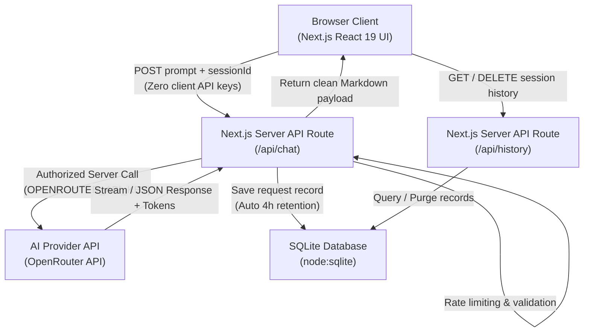

# The AI Signal — AI Model Discovery & Playground

A full-stack web application for discovering, comparing, and testing artificial intelligence models with an interactive playground, live provider integration, and automated session usage tracking.

- **Author**: **Pranjal Yadav** ([@pranjal2410719](https://github.com/pranjal2410719))
- **Live Application**: [https://theaisignal.vercel.app/](https://theaisignal.vercel.app/)
- **Repository**: [https://github.com/pranjal2410719/TheAiSignal-task01](https://github.com/pranjal2410719/TheAiSignal-task01)

---

## 🚀 Key Features

### 1. Model Discovery & Comparison
- **Search & Multi-Filter Catalog**: Real-time filtering by model name, research lab (OpenAI, DeepSeek, Meta, Anthropic, Google), capabilities (vision, open weights, live playground runnable), and context windows.
- **Side-by-Side Matrix**: Compare up to 4 models simultaneously across technical specifications (intelligence score, coding benchmark, context length, max tokens, modalities).
- **Cost Estimator**: Interactive monthly spend calculator factoring in input and output token ratios, custom workloads, and preset volume templates.
- **Deep-linking & URL State**: Active comparison sets synchronize cleanly to URL parameters (`/compare?models=...`).

### 2. Live AI Model Playground
- **Direct Model Execution**: Test leading open models including **Meta Llama 3.3 70B Instruct** and **DeepSeek V3 Chat** via OpenRouter.
- **Refined Output Formatting**: Rich Markdown rendering with structured headings, lists, blockquotes, styled data tables, and syntax-highlighted code blocks with 1-click **Copy Code** and full message copy.
- **Resilient Chat Pipeline**:
  - **Sliding Context Window**: Automatically manages multi-turn history to keep conversations responsive without hitting provider message caps.
  - **Client & Server Validation**: Role enforcement, payload sanitation, and token counting.
  - **Rate Limiting Protection**: Built-in 15 requests/minute sliding-window limiter preventing quota exhaustion.

### 3. Usage History & Persistence
- **SQL Data Storage**: Stores prompt timestamps, models used, prompt/response excerpts, and exact token counts.
- **Automated 4-Hour Retention Engine**: Implements an automatic `4h TTL` cleanup query running periodically on database access to keep history lean and organized.
- **Manual Management**: Instant session history clearing and live refresh controls.

### 4. Atlas/OneAtlas Design System & Modern UI
- Adapted from the warm editorial design system: charcoal dark mode (`#1a1917`, default), warm cream canvas (`#faf9f5`), serif typography (`Source Serif 4`), and pastel brand tiles (`oat`, `sky`, `olive`, `heather`, `cactus`).
- **Kokonut UI Integration**:
  - `AI_Prompt`: Feature-rich chat composer with model selection, effort/thinking levels, file attachments, and `/` command palette.
  - `SwitchButton`: Smooth View Transition circular-reveal dark/light mode toggle.
  - `AICitations`: Inline citations with interactive badge hover cards.
  - `AIMessageQueue`: Follow-up message queuing with drag-and-drop reordering.
- Keyboard shortcut `⌘K` / `Ctrl+K` for global command palette navigation.

---

## 🏗️ Architecture & Security



### Security Principles
- **No Client API Keys**: `OPENROUTER_API_KEY` is strictly confined to the serverless runtime and never bundled in client JavaScript.
- **Sanitized Inputs**: Prompts are constrained to 12,000 characters and validated against an explicit model allowlist.
- **Isolated Sessions**: Clients generate a local browser UUID (`the-ai-signal-session-id`) ensuring isolated usage history per user.

---

## 🛠️ Technology Stack

| Layer | Technology | Details |
|---|---|---|
| **Frontend** | React 19, Next.js 16 (App Router) | Server & Client Components, Lucide Icons |
| **Styling** | Tailwind CSS 4 | Custom `@theme` variables, OneAtlas palette |
| **AI Provider** | OpenRouter Unified API | Llama 3.3 70B, DeepSeek V3, Free tier fallback |
| **Markdown** | Marked + Custom React AST Lexer | Safe tokenized rendering with interactive code copy |
| **Database** | Node built-in `node:sqlite` | Zero external native binary dependencies |
| **Testing** | Vitest | Comparison logic and SQLite retention unit tests |
| **Deployment** | Vercel | Serverless functions with ephemeral `/tmp` storage |

---

## ⚙️ Environment Variables

Copy `.env.example` to `.env.local` for local execution:

```bash
cp .env.example .env.local
```

| Variable | Required | Description | Example |
|---|---|---|---|
| `OPENROUTER_API_KEY` | **Yes** | API key used by `/api/chat` to generate live responses | `sk-or-v1-xxxxxxxx...` |
| `NEXT_PUBLIC_APP_URL` | No | Site URL sent to OpenRouter ranking headers | `https://theaisignal.vercel.app` |
| `SQLITE_DB_PATH` | No | Custom path to SQLite file (defaults to `data/usage-history.sqlite`) | `/tmp/usage-history.sqlite` |

---

## 📦 Getting Started Locally

### Prerequisites
- Node.js 22.0.0 or higher
- npm 10+

### Installation & Run

1. **Clone the repository**:
   ```bash
   git clone https://github.com/pranjal2410719/TheAiSignal-task01.git
   cd TheAiSignal-task01
   ```

2. **Install dependencies**:
   ```bash
   npm install
   ```

3. **Configure Environment Variables**:
   ```bash
   cp .env.example .env.local
   # Add your OPENROUTER_API_KEY to .env.local
   ```

4. **Start the development server**:
   ```bash
   npm run dev
   ```
   Open [http://localhost:3000](http://localhost:3000) to view the application.

5. **Run test suite**:
   ```bash
   npm run test
   ```

6. **Build for production**:
   ```bash
   npm run build
   ```

---

## ⚠️ Deployment Notes & Known Limitations

- **Vercel Serverless Filesystem**: Vercel executes Next.js API routes in stateless lambda instances where the root filesystem is read-only. The application routes SQLite files to `/tmp/usage-history.sqlite`. While suitable for session testing and demonstration, serverless containers are ephemeral and do not share disks across distributed nodes. For multi-node enterprise persistence, connecting a hosted database (such as **Turso / libSQL**, **Neon PostgreSQL**, or **Supabase**) is recommended.
- **Provider Quotas**: OpenRouter free-tier models are subject to upstream traffic availability. Built-in rate limiting (15 req/min) prevents quota starvation.

---

## 👤 Author

**Pranjal Yadav**
- Student, B.Tech Computer Science and Engineering
- GitHub: [@pranjal2410719](https://github.com/pranjal2410719)
- LeetCode: [pranjal_dev](https://leetcode.com/u/pranjal_dev/)
